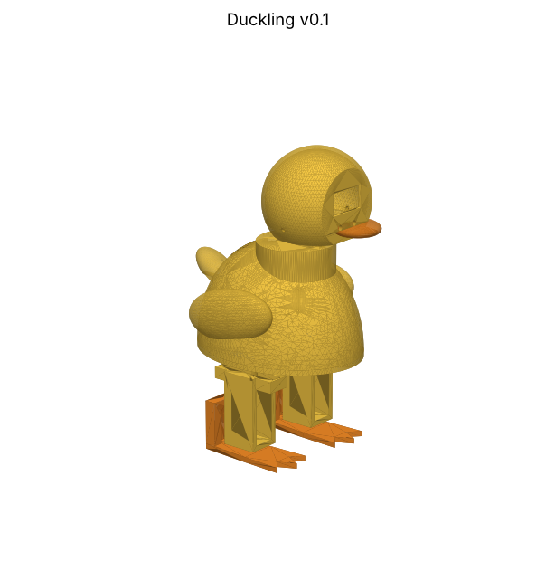

# Duckling v0.1

A 17.5 cm, 3D-printed walking duck. It waddles, dances, turns its head, blinks
OLED eyes, quacks, and is driven from your phone over its own Wi-Fi.
About **$30–35 in parts** plus about 100 g of PLA.



> **Status: prototype, not yet test-printed.** The CAD passes the collision checks
> (`cad/check.py`, `cad/motion_check.py`) and the firmware compiles, but nothing has
> been built yet. Expect to adjust tolerances after the first print.

---

## 1. Parts to buy

Prices are typical AliExpress figures. Search for the exact phrase in the
"Search for" column.

| # | Part | Qty | ~Price | Search for |
|---|------|-----|--------|------------|
| 1 | ESP32-S3 SuperMini (USB-C) | 1 | $4.00 | `ESP32-S3 SuperMini` |
| 2 | MG90S metal-gear micro servo (legs) | 4 | $10.00 | `MG90S servo` |
| 3 | SG90 micro servo (neck) | 1 | $1.50 | `SG90 servo` |
| 4 | 0.96" OLED 128×64, I2C, 4-pin, SSD1306 | 1 | $2.00 | `0.96 OLED I2C SSD1306 4 pin` |
| 5 | MAX98357A I2S amplifier board | 1 | $1.50 | `MAX98357A` |
| 6 | 28 mm 8 Ω 0.5–1 W speaker | 1 | $0.80 | `28mm 8 ohm speaker` |
| 7 | 18650 Li-ion cell, **protected** | 1 | $5.00 | buy from a reputable seller |
| 8 | Single 18650 holder with leads | 1 | $0.50 | `18650 battery holder 1 slot` |
| 9 | IP5306 USB-C charge + 5 V boost module (2.1 A) | 1 | $1.50 | `IP5306 type-c 5V 2.1A module` |
| 10 | SS12D00 mini slide switch | 1 | $0.10 | `SS12D00` |
| 11 | 1000 µF 10 V electrolytic capacitor | 1 | $0.10 | |
| 12 | Perfboard (5×7 cm) + male pin headers | 1 | $1.00 | |
| 13 | 26 AWG silicone wire + female-female jumpers | – | $2.00 | |
| 14 | M3×10 self-tapping screws (shell) | 4 | | |
| 15 | M2×6 self-tapping screws (tray ×4, head ×2) | 6 | | servo screws also work |
| 16 | *Optional:* copper tape (pet sensor), 2× 100 kΩ resistors (battery meter) | | | |

Each servo comes with its horns and three small screws. You need the double-arm
horn (hips, neck) and the single-arm horn (feet).

## 2. Printing (Bambu A1 / AMS Lite)

The STLs in `stl/` are already oriented for printing. Load them into Bambu Studio and
slice with the defaults: **0.2 mm layers, 15% gyroid infill, 3 walls, PLA**.

| Part | Colour | Supports |
|------|--------|----------|
| `shell.stl` | yellow | none |
| `chassis.stl` | yellow | none |
| `leg_left.stl`, `leg_right.stl` | yellow | none |
| `head_shell.stl` | yellow | tree (auto), for the inside of the dome |
| `head_base.stl` | yellow | none |
| `tray.stl` | any | none |
| `foot_left.stl`, `foot_right.stl` | orange | none |
| `beak.stl` | orange | none |

Every part is a single colour, so the AMS Lite only saves you swapping
spools. Two plates covers everything: one yellow, one orange.

**Fit test first.** Print one `leg_left.stl` (about 40 min) and push an MG90S into
it before printing the rest. If it's too tight or too loose, change `CLR` in
`cad/duckling.py` and re-export (see section 7).

## 3. Wiring

```
 18650 ─► IP5306 module ─► 5V OUT ─► slide switch ─► 5V RAIL (perfboard)
          (USB-C charges)                              │
                                                       ├─ 1000µF cap (+ to rail, − to GND)
                                                       ├─ servo red wires ×5
                                                       ├─ ESP32 "5V" pin
                                                       └─ MAX98357A VIN
 All grounds joined: battery −, module GND, servos (brown), ESP32 GND, amp GND, OLED GND
```

| ESP32-S3 SuperMini pin | Goes to |
|------------------------|---------|
| GPIO1 | Left hip servo (orange/signal) |
| GPIO2 | Right hip servo |
| GPIO3 | Left ankle servo |
| GPIO4 | Right ankle servo |
| GPIO5 | Neck servo |
| GPIO8 | OLED SDA |
| GPIO9 | OLED SCL |
| 3V3 | OLED VCC |
| GPIO10 | MAX98357A BCLK |
| GPIO11 | MAX98357A LRC |
| GPIO12 | MAX98357A DIN |
| GPIO7 | *(optional)* wire to a copper-tape pad on the head: pet the duck |
| GPIO6 | *(optional)* middle of a 100k/100k divider across the battery: battery meter |

Speaker → MAX98357A `+` and `−`. "Left" and "right" are the duck's own left and right.

**Servo board:** solder 5 rows of 3 male header pins on the perfboard. One column
goes to the 5 V rail, one to GND, and one is the signal column, with each signal
pin wired to its GPIO. The servo plugs then push straight on.

> ⚠️ Use a **protected** 18650, never short the cell, and don't leave it charging
> unattended. If the cell gets hot, unplug it.

## 4. Flash the firmware

Using [PlatformIO](https://platformio.org/) (VS Code extension, or `pip install platformio`):

```
cd firmware
pio run -t upload
```

*(A one-click browser flasher is planned for the website.)*

## 5. Assembly

> **Golden rule:** power the duck up *before* fitting any servo horns. The firmware
> moves every servo to centre (90°) on boot. Fit each horn with the joint in its
> straight position.

1. **Hip servos into the chassis.** Drop each MG90S into its slot from above, shaft
   pointing **down** through the deck and cable towards the middle. Screw the tabs
   down with the servo's screws.
2. **Leg onto hip.** Press a double-arm horn into the pocket on top of a leg and
   secure it with the tiny horn screws. Push the leg onto the hip spline with the
   leg pointing straight forward. Drive the horn's centre screw through the access
   hole in the bottom of the leg.
3. **Ankle servo into the leg.** Slide an MG90S into the leg from the front, with
   the shaft out the back. Screw the tabs. Feed the cable up through the deck hole
   in front of the hip.
4. **Foot.** Press a single-arm horn into the foot's pocket with the arm pointing
   down. Push the foot onto the ankle spline with the sole flat and screw it from
   the back.
5. **Neck servo.** From inside the shell, push the SG90 up into the collar, shaft
   up, and screw the tabs.
6. **Electronics.** Lay the battery holder between the rails on the deck. Push the
   switch into the slot underneath. Screw the tray onto its posts and stick the
   ESP32, IP5306 module and amp onto it with double-sided foam tape, both USB-C
   ports facing the back slots. Glue the speaker under the grille on the duck's
   back.
7. **Close the body.** Lower the shell onto the chassis and fit 4× M3 screws from
   underneath.
8. **Head.** Press a double-arm horn into `head_base` and push it onto the neck
   spline facing forward. Screw through the centre. Tape the OLED behind the face
   window, run its 4 wires down through the hole in `head_base` and the collar, and
   leave some slack for head turns. Glue the beak pegs into the face. Push
   `head_shell` onto the base and fit 2× M2 screws.

## 6. Play and calibrate

1. Switch on. The duck quacks and makes a Wi-Fi network called `Duckling-XXXX`
   (password `quackquack`).
2. Join it from your phone. The control page should open by itself. If not, go to
   `http://192.168.4.1`.
3. Open **Setup & calibration**. Nudge each slider until the legs are straight and
   the feet flat, then press **Save**.
4. Press ⬆. If it walks backwards or stumbles, tick **reverse** on the ankle
   servos and try again.

## 7. Changing the design

The CAD is Python ([build123d](https://build123d.readthedocs.io)). Every dimension
is a named constant at the top of `cad/duckling.py`.

```
pip install build123d trimesh matplotlib
cd cad
python3 duckling.py       # re-export all STLs
python3 check.py          # parts/servos must not overlap
python3 motion_check.py   # sweep the gait range for collisions
python3 render.py         # preview images in renders/
```

## Known risks to check on the first build

- **Servo pocket fit.** SG90/MG90S clones vary by ±0.3 mm. Do the leg fit test first.
- **Horn pockets.** Horn sizes vary by brand. If yours don't fit, adjust
  `HORN_HUB_D` and `HORN_ARM_W`.
- **Power.** The IP5306 is rated 2.1 A. Five servos moving together can dip the
  supply and reset the ESP32. If the duck reboots mid-walk, that's the cause. The
  fix is a 3 A boost module.
- **Gait tuning.** The walk uses Otto-style oscillator parameters. Our ankle
  geometry differs from Otto's, so amplitudes in `firmware/src/motion.cpp` may need
  adjusting.
- **Head dome.** Printing the inside of the dome needs supports. If the result is
  ugly, v0.2 will split the head differently.
